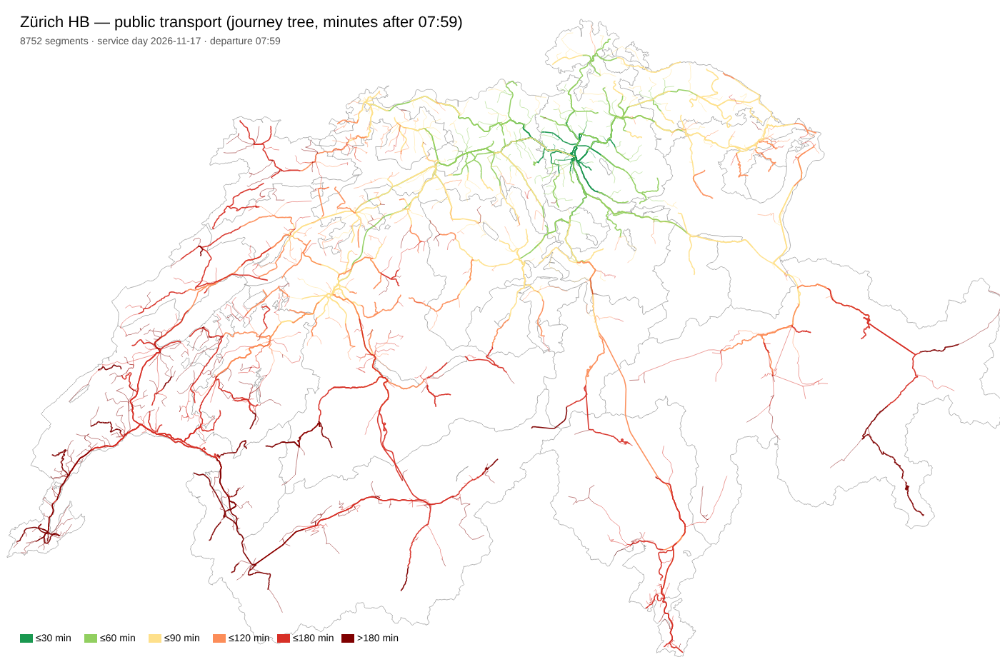
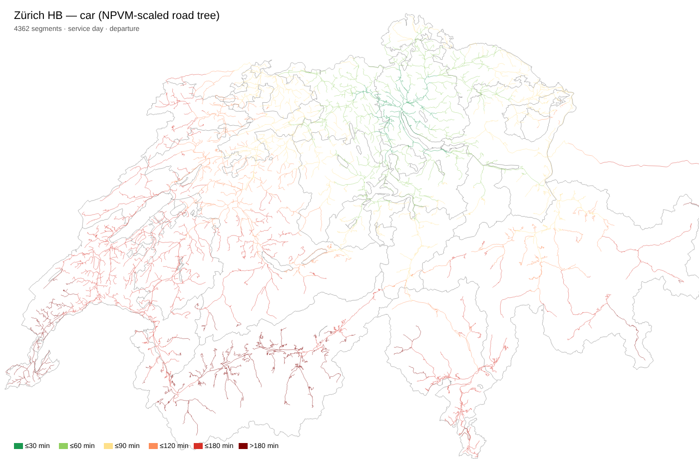
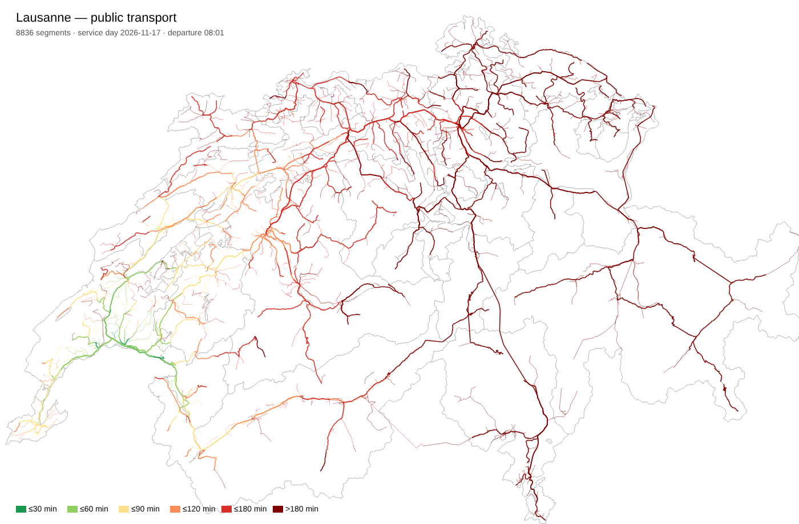

# Checkpoint 3 — Data ready for the frontend

Status: **ready for owner review** (2026-11-10). Brief §5: present the quality report, the metric count per theme and level, and sample reach outputs for two hubs; agree on gaps before building the frontend.

## In one paragraph

All agreed national sources and the cantonal `*` compilations are ingested (61 connectors), harmonized onto the 2026 municipality state, aggregated to every level, and checked. **721 metrics** exist, **692 at municipality level**, many with long histories (votes since 1960, population balance since 1981, agriculture since 1975, tax since 2003). **586 metrics are cleared for shipping**. The other 135 come from 12 sources whose licence terms are not yet confirmed and are held back (brief rule 5). Public-transport and car reach is built for all 20 hubs. `make data` rebuilds everything from the cached downloads.

## 1. Quality (plausibility sweep, D13) — [`quality_report.md`](quality_report.md)

| Check | Result |
|---|---|
| Municipalities add up to published district/canton/national values | **620 of 633** metric×level comparisons pass. Differences are computed and labeled for canton transfers (Moutier, Clavaleyres, Vellerat, Laufental), the territory of each vote date, and amounts sources publish only at canton level ("unallocatable", Swiss abroad, "municipality unknown") |
| Ranges (shares 0–100, no negative counts) | 1 flag: one municipality-year where STATENT's "values < 4 set to 4" rule gives a job share of 114% (documented) |
| Cross-source | GWS dwellings = vacancy-count dwelling stock in **33,760 of 33,760** municipality-years. STATPOP = demographic balance in 31,602 of 31,650. Land area vs. land-use statistics: 2,104 of 2,110 within 5% |
| Year-on-year jumps | Remaining flags are real events or BFS reclassifications, listed per metric; lumpy series (construction investment) are marked volatile |
| Coverage | per metric and latest period in section D of the report; every gap has a reason (suppressed, not covered, not published, no data) |

**What the sweep caught and fixed**, logged in [`qa_resolution.md`](qa_resolution.md):
- **Construction spending:** dropped "unallocatable" amounts, up to 98% of a canton's maintenance spending.
- **Vehicles, crime, unemployment:** missing "municipality unknown" rows.
- **Land use:** lakes and condominium areas outside any municipality were missing.
- **Population balance:** Thurgau's 1990s reform municipalities showed population 0 before they existed.
- **Shared code:** partial sums on merged municipalities, and Kommunanzen counted as municipalities.

**Open (13 comparisons, all small):**
- Eligible voters for some votes in BS, JU and GE: the published canton totals include Swiss abroad whose eligible counts BFS doesn't publish per municipality.
- 9 district land-use differences of 1–2 ha.
- A few single cells, such as 1972 AI/SO votes that don't add up in BFS's own data.

## 2. Metrics per theme and level

| Theme | Metrics built | Cleared to ship | partial/`*` | Gemeinde | Bezirk | Kanton | Agglomeration | Labour market area | CH |
|---|---|---|---|---|---|---|---|---|---|
| Geography & identity | 10 | 1 | 0 | 10 | 6 | 6 | 6 | 6 | 6 |
| Population & demography | 26 | 26 | 0 | 26 | 26 | 26 | 26 | 26 | 24 |
| Migration & nationality | 49 | 49 | 0 | 49 | 49 | 49 | 49 | 49 | 49 |
| Language & religion | 58 | 58 | 0 | 29 | 58 | 29 | 29 | 29 | 58 |
| Households & family | 39 | 39 | 0 | 39 | 39 | 39 | 39 | 39 | 30 |
| Economy & jobs | 75 | 73 | 2 | 75 | 75 | 75 | 75 | 75 | 44 |
| Income & tax | 52 | 23 | 0 | 52 | 23 | 22 | 23 | 23 | 11 |
| Public finances | 4 | 0 | 4 | 4 | 2 | 2 | 2 | 2 | 0 |
| Housing & buildings | 73 | 73 | 0 | 73 | 71 | 71 | 71 | 71 | 71 |
| Real estate prices | 3 | 0 | 3 | 3 | 1 | 1 | 1 | 1 | 0 |
| Land use & built environment | 39 | 39 | 0 | 39 | 39 | 39 | 39 | 39 | 39 |
| Mobility & accessibility | 136 | 93 | 2 | 136 | 94 | 94 | 94 | 94 | 86 |
| Energy & climate | 26 | 21 | 0 | 26 | 12 | 12 | 12 | 12 | 12 |
| Environment & hazards | 25 | 10 | 8 | 25 | 25 | 25 | 25 | 25 | 17 |
| Health & social | 8 | 2 | 0 | 8 | 1 | 1 | 1 | 1 | 0 |
| Education | 14 | 12 | 2 | 14 | 11 | 11 | 11 | 11 | 2 |
| Safety | 17 | 0 | 6 | 17 | 17 | 17 | 11 | 17 | 11 |
| Politics | 67 | 67 | 0 | 67 | 67 | 65 | 67 | 67 | 0 |
| **All** | **721** | **586** | **27** | **692** | 616 | 584 | 581 | 587 | 460 |

Metrics missing at higher levels are medians, indices or published rates (`not_aggregatable`); per the brief they appear only at their native level. Tax burden, multipliers and election shares are examples.

## 3. Reach — [`reach_method.md`](reach_method.md)

- **Public transport:**
  - Built from the national timetable, Tuesday 17 Nov 2026, all modes.
  - Each value is the median over departures 07:30–08:30, routed with our own connection scan because OpenStreetMap is not reachable.
  - It agrees with the official ARE transport model at r = 0.96, with 88% of 42,140 hub–municipality pairs within ±15%.
  - Zürich HB → Bern takes 56 min, → Basel 53 min.
- **Car:** times from the ARE NPVM 2023 model (CC BY), population-weighted per municipality, available for all 2,110 municipalities.
- **Growing lines:**
  - Rail legs follow the federal rail network, buses are drawn straight, cars use swisstopo roads.
  - There are 40 files, 169–208 KB gzipped each.

Sample outputs for two hubs:

Known limits:
- Car trees occasionally route through Austria, France or Italy, and the car-train shuttles (Lötschberg, Furka, Vereina) are missing from the drawing; the car times themselves come from NPVM.
- The timetable year changes on 13 Dec 2026, so rebuild reach after that.

## 4. Data delivery to the browser (brief 6.3) — measured

| File | Size (gzip) |
|---|---|
| Municipality boundaries (TopoJSON) | 255 KB |
| `units.json` (all units, names, parents, label points) | 62 KB |
| `metrics.json` (catalog) | ~35 KB |
| `latest/gemeinde.json` — all 586 metrics, latest period | **1.86 MB** |
| `series/<metric>.json`, `votes/<vote>.json` | on demand, 511 + 511 files |
| `reach/<hub>_<mode>.json` | on demand, ~0.2 MB each |

The all-metrics municipality file alone uses most of the ~3 MB initial budget.

## 5. Decisions for the owner

1. **Licences — 12 sources held back** ([`licences.md`](licences.md), [`../pipeline/licence_review.yaml`](../pipeline/licence_review.yaml)).
   - Held back: area/elevation (swisstopo), accidents (ASTRA), air quality (BAFU), tax burden and multipliers (ESTV calculator), accessibility to services (BFS grid), health premiums (BAG), and the cantonal `*` sources.
   - Most are federal open geodata whose catalog entry says "proprietary"; the binding terms page isn't reachable from here.
   - **A (recommended):** allow the terms-page hosts (geo.admin.ch, swisstopo, ESTV) for one verification pass, then clear or block each source with evidence.
   - **B:** you accept "federal geodata, free of charge with attribution" as cleared, and I confirm the remaining non-federal ones.
   - **C:** ship without them for now.
2. **Initial payload.**
   - **A (recommended):** split the latest values into a core file (~60 headline metrics, about 0.3 MB) plus one file per theme loaded on first use.
   - **B:** keep one file (1.9 MB).
3. **Metric curation.** 721 metrics is too many for a selector.
   - **A (recommended):** I propose ~60 headline metrics shown first per theme, with everything else under "all metrics" plus search. You review the headline list.
   - **B:** show all, grouped by theme.
4. **National requests for crime, pupils and unemployment.** The cantonal sweep found these figures all originate at BFS (crime, pupils) and SECO (unemployment). An email request could give all 26 cantons instead of 2–3.
   - **A:** you send the requests; I draft them.
   - **B:** keep the partial `*` coverage.
5. **Additional cantonal hosts** found by the sweep (data.zg.ch, stada2.sg.ch, daten.statistik.zh.ch, www.ebericht.be.ch, a few others). They would raise finance coverage from 9 to about 11 cantons.
   - **A:** allow.
   - **B:** skip for v1.
6. **Tech stack for Phase 4 (brief 6.4).**
   - Proposal: TypeScript + Vite + MapLibre GL, with Svelte for the UI state.
   - Static hosting on GitHub Pages; data built locally or in this environment and published as a release artifact.
   - A monthly GitHub Action can't run the full rebuild, because raw data is about 7 GB and the build needs far more than a runner's limits. The proposal is a monthly *check* job plus a manual rebuild.
   - Confirm, or name an alternative.
7. **Duplicates.** Births come from two BFS sources (balance 1981+, BEVNAT 1969+).
   - Proposal: keep BEVNAT for births, marriages and divorces, and the balance for the migration and natural-change components.
